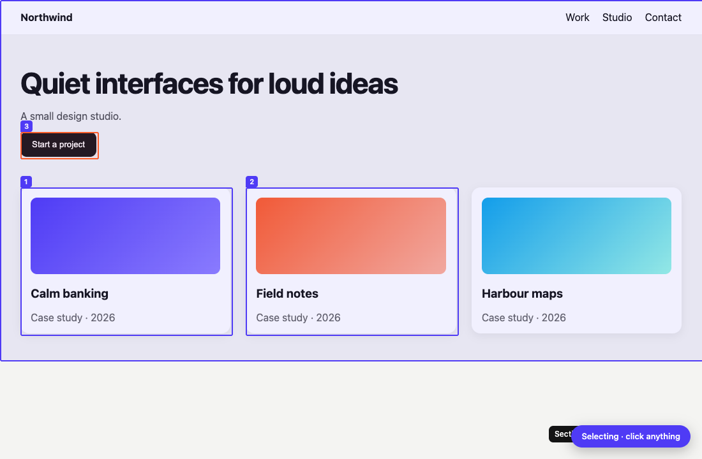
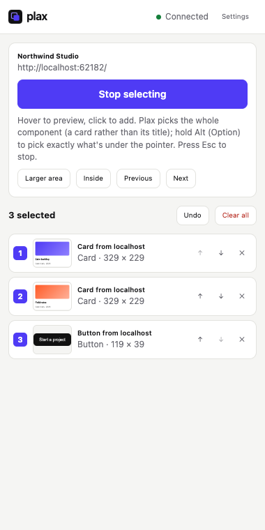
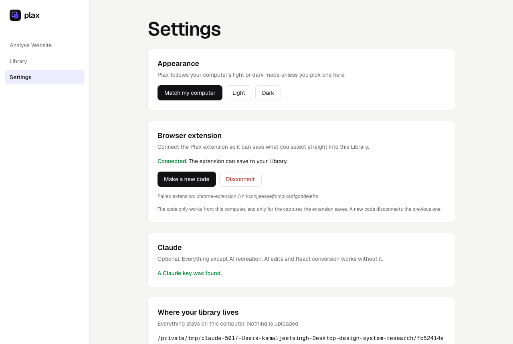
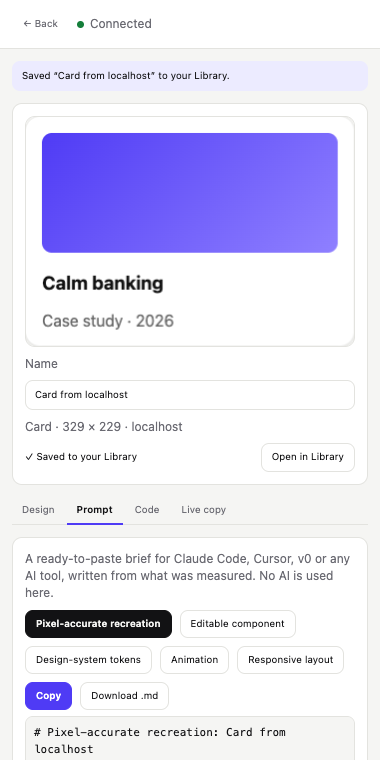
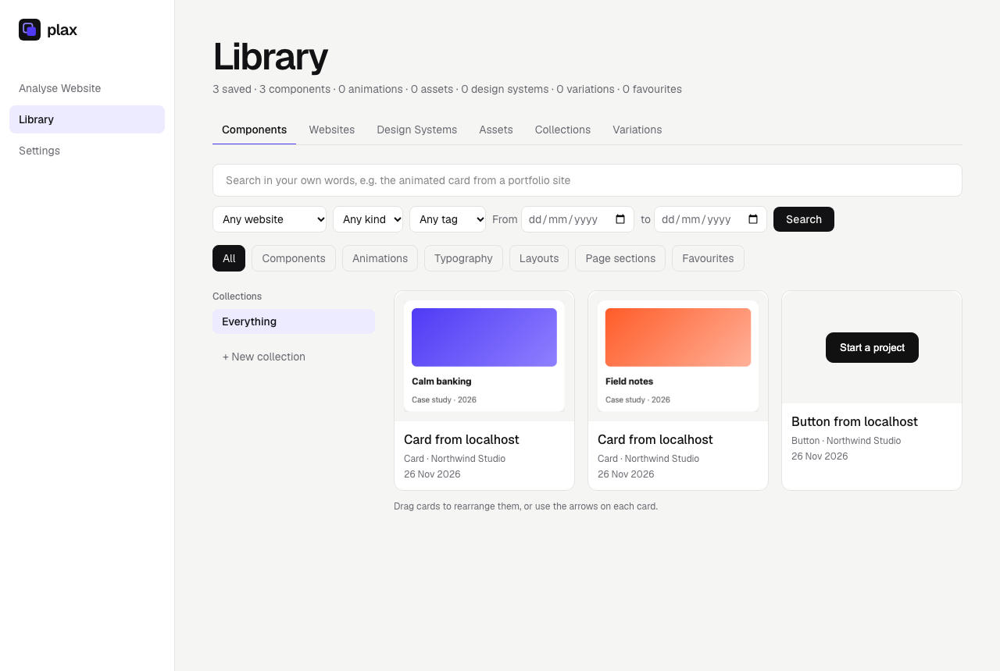
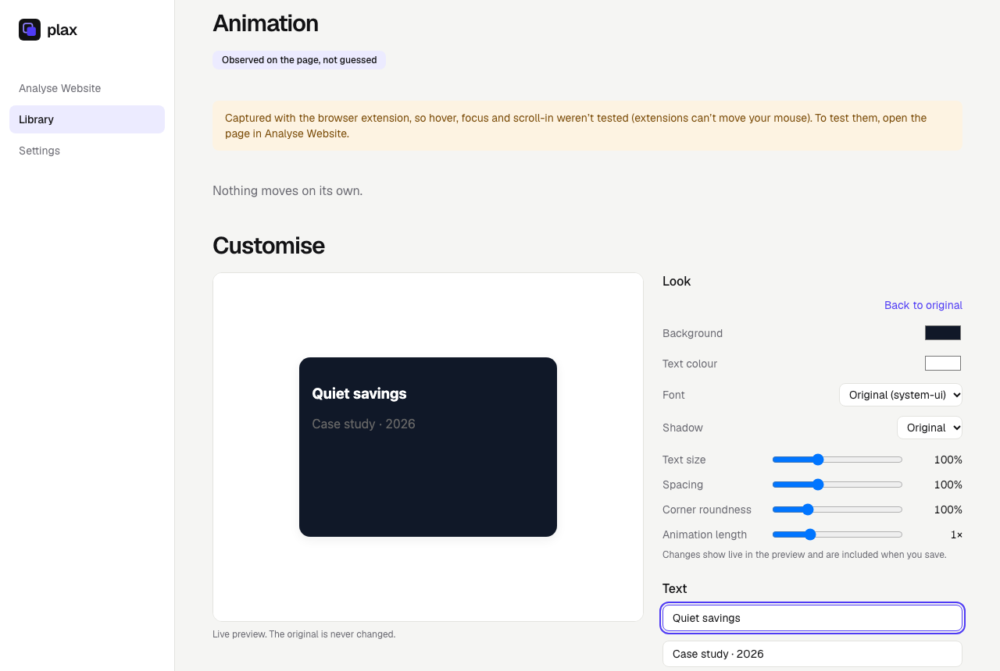

# Plax

Select what you like on any website, see exactly how it's built, and turn it into prompts, code and
a personal library you can reuse. Plax runs on your own computer: a Chrome extension for selecting,
and a local app for your Library.

> Repository: `website-crawler`. Version 2.0.0 (was *Personal Design Intelligence* 1.0).

<p>
  
  
</p>

## What you can do

- **Select several things on a page** with the Chrome extension: hover to preview, click to add.
  Plax picks the whole component (a card, not just its title); hold Alt (Option) to pick exactly
  what's under the pointer. Reorder, remove, undo and clear in the side panel.
- **See how each one is built**: colours, type, spacing, layout, corners, shadows and motion,
  measured on the page, never guessed. A live, exact copy of each selection.
- **Build a prompt** for Claude Code, Cursor, v0 or any AI tool, in five modes: pixel-accurate,
  editable component, design-system tokens, animation, responsive.
- **Export code**: HTML/CSS (the exact copy), Tailwind, design tokens (JSON) and React.
- **Save to your Library** with one button, grouped by website.
- **Customise** a saved item (colours, font, text, pictures, size, shape, layout) and keep the result
  as a **variation**. The original never changes.
- **Analyse Website** in the app: the same selection in a separate browser window, plus tests of
  hover, focus and scroll animations, Claude recreation and phone/tablet/desktop sizes.
- **Collect a whole design system** and download it as `design.md`.
- **Use everything from Claude Code** through the built-in MCP server.

## What works where

| Works on its own, on your computer | Needs a Claude key (optional) | Uses the internet |
|---|---|---|
| Selecting, measuring, pictures, exact copies | Recreate with Claude, Improve the match, Change by instruction | Opening the websites you analyse (as any browser does) |
| Build Prompt (all five modes) and code export | Convert to React with Claude | Claude requests, if you add a key |
| Library, collections, search, look-alikes, variations | | |
| Design systems and `design.md`, the MCP server | | |

Without a key, every Claude button says so plainly and the no-AI version is offered instead. The
React export without a key is clearly labelled as the exact copy wrapped in a component.

## Install

You need **Node.js 22.18 or newer** and **Google Chrome**.

```bash
npm install
```

```bash
npx playwright install chromium
```

```bash
npm run dev
```

Then open http://localhost:3000. (Optional: copy `.env.example` to `.env.local` and add your
`ANTHROPIC_API_KEY`, then restart.)

### Install the Chrome extension

```bash
npm run extension:zip
```

This makes `dist/plax-extension-2.0.0.zip` and the folder `dist/extension`. Then:

1. Open `chrome://extensions` in Chrome.
2. Turn on **Developer mode** (top right).
3. Press **Load unpacked** and choose the `dist/extension` folder.
4. Pin Plax (the puzzle-piece icon → pin), then click the Plax button to open its side panel.

Step by step, with permissions and limits: [docs/EXTENSION.md](docs/EXTENSION.md).

### Connect the extension to your Library

1. In the app, open **Settings → Browser extension → Connect the extension**. Copy the code.
2. In the side panel, open **Settings**, paste the code and press **Connect**.

The dot in the panel turns green. **Save to Library** now sends selections to the app.



## Using Plax

**In the extension**

1. Open a website, click the Plax button, press **Start selecting**.
2. Click everything you want: navigation, hero, buttons, cards. Each gets a number on the page.
   Use **Larger area**, **Inside**, **Previous** and **Next** to adjust the newest one.
3. Open a selection to see its **Design**, a **Prompt**, its **Code** and a **Live copy**.
   Copy or download anything. Press **Save to Library** to keep it.



**In the app**

- **Analyse Website** opens a site in its own window for deeper checks: hover, focus and scroll
  animations, Claude recreation, and how it looks at phone, tablet and desktop widths. Details are
  in tabs: Design, Motion, Recreate, Prompt & code, Sizes. One **Save to Library** per selection.
- **Library** has tabs for Components, Websites, Design Systems, Assets, Collections and
  Variations. Search in your own words, filter, star favourites, drag (or use the arrows) to
  rearrange, select several to add to a collection, compare or delete.
- **An item's page** has its preview, measured design, animation, notes, tags, version history,
  look-alikes, **Customise**, **Build a prompt** and **Code**.

<p>
  
  
</p>

## Using your Library from Claude Code

The project includes a local MCP server (`mcp/server.ts`). It runs on your computer only.

1. Open Claude Code **in this folder**. It finds `.mcp.json` and asks once whether to allow the
   `design-library` server. Say yes.
2. Ask in plain words: "Find my best navigation animations", "Make a React version of the magnetic
   button I saved", "Compare my three hero sections".

| Tool | What it does | Changes anything? |
|---|---|---|
| `search_library` | Find items in plain words, by filter, collection or tag | No |
| `get_item` | Everything about one item: tokens, motion, recreation, notes, files | No |
| `get_code` | A component's HTML/CSS and React code | No |
| `get_animation` | How it moves: on its own, hover, focus, scroll, with timing | No |
| `get_design_tokens` | A design system's `design.md`, or a component's tokens | No |
| `get_assets` | Images, icons, fonts, screenshots (with a licence reminder) | No |
| `get_preview` | The item's screenshot, so Claude can look at it | No |
| `compare_items` | 2–4 items side by side | No |
| `find_similar` | Look-alikes of an item or of a picture on this computer | No |
| `list_collections` | Your collections | No |
| `save_variation` | Saves new code as a **new** variation; the original is never changed | Adds, after you agree |
| `update_item` | Name, notes, tags, favourite | Edits, after you agree |
| `add_to_collection` | Adds items to a (new) collection | Edits, after you agree |

To use it from any folder, register it once:

```bash
claude mcp add design-library --scope user -- node --no-warnings ~/Desktop/design_system_research/website-crawler/mcp/server.ts
```

## Privacy and security

- The app only answers on this computer (it listens on 127.0.0.1). Other devices on your network
  and other websites you visit can't reach it.
- The extension can save only after you pair it. The code is shown once, stored only as a
  fingerprint (hash), and tied to the first extension that uses it; a new code or **Disconnect**
  revokes it. Even paired, the extension can only save captures, nothing else.
- The extension asks for: the side panel, the tab you click it on (`activeTab`), running its
  selection layer there (`scripting`), its own storage, and `localhost` (to reach the app). Access to
  every website is optional and asked for only if you choose it.
- Your library stays in `data/`, which is never committed. The database is backed up automatically
  before any change to its structure.

## Where things live

| Path | What | In Git? |
|---|---|---|
| `src/` | The app (Next.js) and the shared in-page readers | yes |
| `extension/` | The Chrome extension's source | yes |
| `scripts/build-extension.mjs` | Builds the extension and its ZIP | yes |
| `db/migrations/` | Database structure | yes |
| `mcp/` | Local MCP server for Claude Code | yes |
| `docs/` | Architecture, extension guide, audit, roadmap | yes |
| `dist/` | The built extension and its ZIP | no |
| `data/` | **Your** library: database, screenshots, code | **no**, never |
| `.env.local` | Your keys | **no**, never |

How it works inside: [docs/ARCHITECTURE.md](docs/ARCHITECTURE.md). Contributing:
[CONTRIBUTING.md](CONTRIBUTING.md). The Plax plan: [docs/PLAX-AUDIT.md](docs/PLAX-AUDIT.md).

## Tests and releases

```bash
npm test
```

The tests open test pages in an invisible browser, including the real extension; your library is
never touched. GitHub runs lint, build and every test on each push. To publish a release (with the
extension ZIP attached), push a version tag:

```bash
git tag v2.0.0 && git push origin v2.0.0
```

## Troubleshooting

- **`node:sqlite` not found:** update Node to 22.18 or newer.
- **The Analyse Website window doesn't open:** run `npx playwright install chromium`.
- **"Plax needs permission for this page":** click the Plax button in Chrome's toolbar on that tab,
  or choose *Allow on every website* in the panel's Settings.
- **"Chrome doesn't let extensions work on this page":** Chrome's own pages and the Web Store are
  off-limits to every extension. Open a website instead.
- **"The Plax app isn't answering":** start it with `npm run dev`, and check the address in the
  panel's Settings (`http://localhost:3000`).
